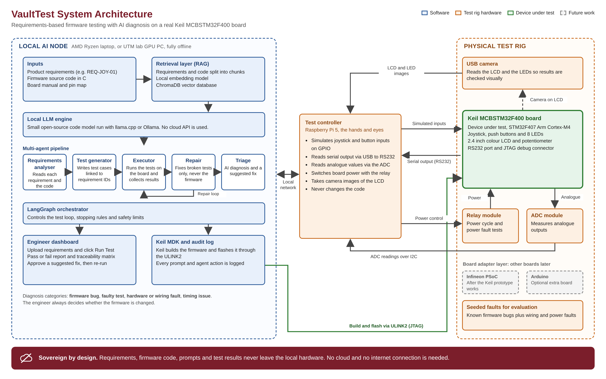

# VaultTest

**A Sovereign Multi-Agent LLM System for Hardware-in-the-Loop Test Generation and Failure Triage of Embedded Firmware**

Final Year Project (SAIA 3122 FYP 1 / FYP 2), Bachelor of Artificial Intelligence, Universiti Teknologi Malaysia
Student: Kaveetiran A/L Sitambaram (A24AI0038) · Supervisor: Assoc. Prof. Dr. Noor Azurati binti Ahmad@Salleh

---

## What it does

An engineer uploads product requirements. VaultTest writes test cases for each requirement, builds and flashes the firmware, runs the tests on a real board through a small test rig, and reports pass or fail per requirement. When a test fails, the AI explains why and suggests a fix. The engineer approves every change. Everything runs offline on local hardware, so no source code leaves the machine.



## Hardware

| Part | Role |
|---|---|
| Keil MCBSTM32F400 (STM32F407) | Device under test |
| ULINK2 + Keil MDK (Windows) | Build and flash |
| Raspberry Pi 5 | Test controller: GPIO inputs, serial capture, relay, ADC, camera |
| AMD Ryzen laptop (Vulkan) or UTM lab GPU PC | Local AI node |

## Software

| Layer | Tool |
|---|---|
| Local LLM | llama.cpp / Ollama with Qwen2.5-Coder |
| Retrieval | ChromaDB + local embedding model |
| Agents | Requirements analyser, Test generator, Executor, Repair (fixes tests only), Triage |
| Orchestration | LangGraph |

## Repository layout

```
docs/          PRD, diagrams, meeting notes
requirements/  Sample product requirements (REQ-*)
firmware/      Board firmware and seeded-fault variants
rig/           Raspberry Pi test controller scripts
src/vaulttest/ AI agents, RAG, orchestrator, report
tests/         Unit tests for VaultTest itself
eval/          Seeded-fault experiments and results
```

## Progress

See **[PROGRESS.md](PROGRESS.md)** for the live checklist and **[Milestones](../../milestones)** / **[Issues](../../issues)** for tasks.

| Phase | When | Status |
|---|---|---|
| 0. Title, proposal, PRD, diagrams | FYP 1 | ✅ Done |
| 1. Literature review (Chapter 2) | FYP 1 | ⏳ Not started |
| 2. Toolchain and board bring-up | FYP 1 | ⏳ Not started |
| 3. System and rig design (Chapter 3) | FYP 1 | 🟡 Diagrams done |
| 4. First end-to-end test (joystick) | FYP 1 | ⏳ Not started |
| 5. FYP 1 report and presentation | FYP 1 | ⏳ Not started |
| 6. Full rig and all five agents | FYP 2 | — |
| 7. Seeded-bug experiments | FYP 2 | — |
| 8. Final report and demo | FYP 2 | — |
